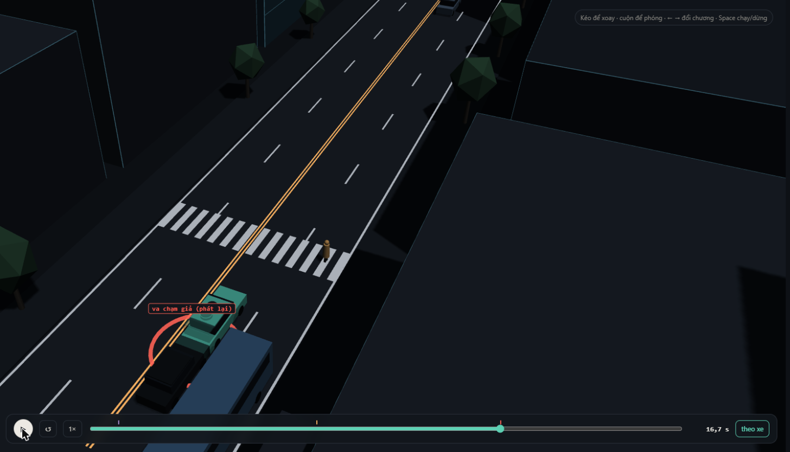
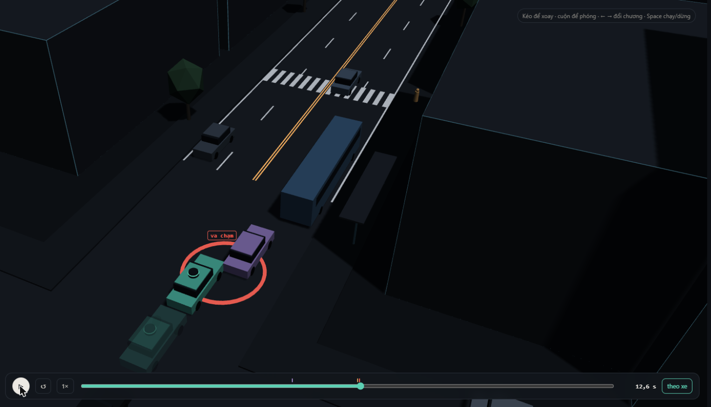
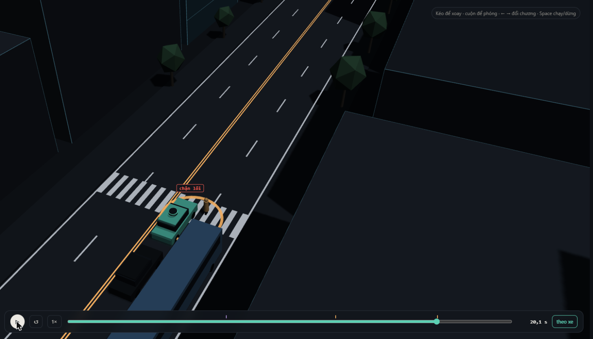
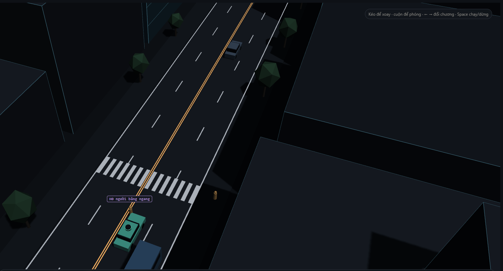
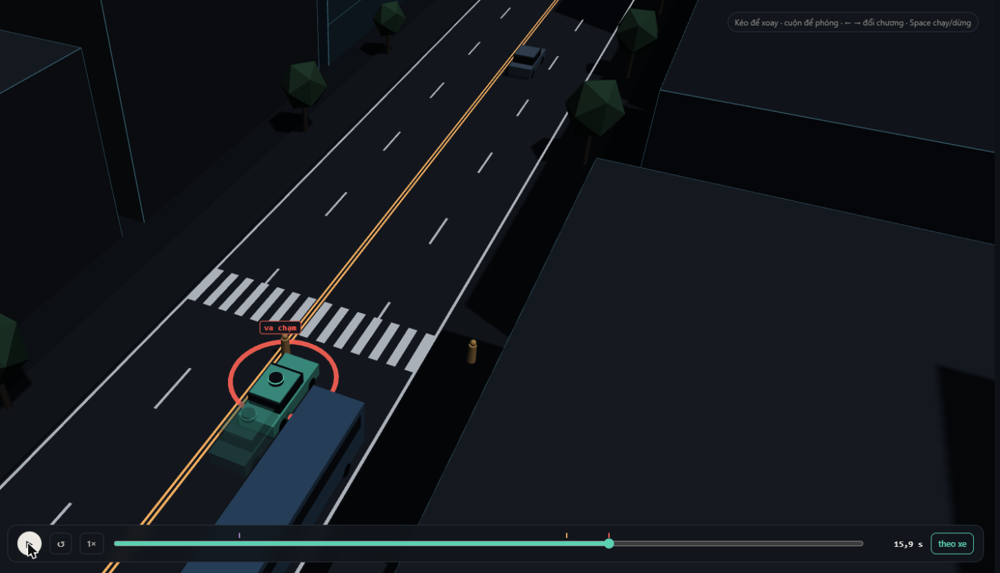

MSSV: 202602900

# Lab 11 · Scenario Forge — báo cáo

Mỗi câu: trả lời ngắn, **trích số từ `evidence/`** (ghi tên file và trường, ví dụ `mc.json: crashes = 4`). Grader chạy lại với MSSV của bạn; số không khớp `evidence/` thì mất điểm phần D (RUBRIC), và câu dựa trên số sai khó được điểm đầy đủ. Không cần văn hay: một bảng nhỏ và hai, ba câu giải thích là đủ.

Thị trấn của bạn (`meta.json: _run.town`): **B** (thị trấn "mưa nhiều hơn": P(ướt) = 0,30, khe chuyển làn trung vị 12 m). Mọi bước chạy bản đầy đủ, không `--quick` (`meta.json: steps.*.quick = false`; `_run.budgets`: replay_n 400, mc_n 3000, iters 8 × per_iter 300, final_n 600, fix_n 400, mine_n 1500).

> Quy ước: số không ghi nguồn file là số suy ra từ số trong ngoặc. Số đánh dấu **[chạy thêm]** lấy từ các lần chạy phân tích ngoài `evidence/` (script không sửa `avsim/`, không đổi seed của pipeline), không phải bằng chứng nộp.

## 1. Phát lại log có trung thực không? (bước A)

| `replay.json` | giá trị |
|---|---|
| `n` / `dropped_human_crash_logs` / `n_used` | 400 / **0** / 400 |
| `replay.crashes` (planner trên log phát lại) | **117**: `contact.rear = 107`, `contact.side = 10` |
| `reactive.crashes` (planner trong thế giới phản ứng) | **1**: `contact.front = 1` |
| `crash_in_both` | **0** |

Không log nào bị bỏ: người lái IDM của thị trấn B không tự gây va chạm trong 400 kịch bản này.

**Vì sao "phát lại" gần như toàn `rear`, và vì sao đó là va chạm giả.** Planner thận trọng hơn người lái trong log: gần vạch qua đường bị xe buýt che, nó giảm về `cautionV` = 7,5 m/s và dừng nhường người đi bộ, còn người lái thật đi qua luôn. Xe bám đuôi TG trong log được ghi lại khi bám **người lái**, nên lúc phát lại nó vẫn chạy đúng quỹ đạo cũ. Nó không biết xe phía trước giờ phanh sớm hơn, không phanh theo, và đâm vào đuôi xe ta. Ngoài đời TG sẽ phản ứng, nên đây là va chạm do phương pháp kiểm thử tạo ra chứ không phải lỗi planner. Trong thế giới phản ứng, đúng 400 kịch bản đó chỉ có 1 va chạm, và không kịch bản nào va chạm ở cả hai (`crash_in_both = 0`). Trong 20 kịch bản đầu của `replay_only`, xe đâm xe ta là TG 17 lần và C2 3 lần **[chạy thêm]**.

**Một kịch bản cụ thể: `replay_only[0]`** (`scenario = 1`, `contact = rear`, `min_ttc_reactive = 3.0`; đường ướt μ = 0,5; ảnh `evidence/shots/q1-R01-replay-fake-rear.png`, chương 9 run R-01). Từ 12,7 s planner chạy chế độ thận trọng ~7,3 m/s vì vạch bị xe buýt che. Lúc 14,7 s nó thấy người đi bộ P1, phanh ở μg = 4,9 m/s² và gần dừng hẳn trước vạch (x ≈ 114, 0,9 m/s lúc 16,7 s). Người lái trong log lúc đó đã qua vạch ở ~10 m/s (x = 123,5 lúc 14,7 s). TG phát lại theo log vẫn giữ ~5–6 m/s rồi đâm đuôi xe ta lúc **16,7 s** (trình xem ghi "va chạm giả (phát lại)"). Trong thế giới phản ứng, cùng thời điểm đó TG đã chậm còn 4,1 m/s và cách đuôi xe ta 6,7 m, TTC nhỏ nhất 3,0 s, không va chạm **[chạy thêm: dựng lại cảnh từ `replay_only[0].params`]**.

## 2. Kịch bản bất khả thi (bước B)

Luật trong `lab11/feasible.py: is_feasible` (loại nếu **bất kỳ** luật nào sai):

| Luật | Căn cứ vật lý |
|---|---|
| Chuyển làn cosine 3,5 m trong `cutDur` giây có gia tốc ngang đỉnh a_lat = (π/cutDur)²·3,5/2; loại nếu a_lat > μg | Lực ngang lớn nhất lốp truyền được là μ·m·g (vòng tròn ma sát). Vượt mức đó xe trượt, không chuyển làn được theo quỹ đạo này. Đường khô μg = 7,85 m/s² nên cutDur tối thiểu ≈ 1,49 s; đường ướt μg = 4,9 m/s² nên tối thiểu ≈ 1,88 s |
| Phanh sau khi vào làn `cutBrake` > μg | Cũng là giới hạn ma sát dọc: không xe nào giảm tốc mạnh hơn μg (ướt 4,9 m/s²) |
| Người đi bộ `pedV` > 2,5 m/s | Đó là chạy, không còn là đi bộ (người đi bộ thường 1,2–1,5 m/s). Mô hình người đi bộ (nhường, nhìn khe) không đúng cho người chạy |
| `cutV` ngoài (0, 22] m/s | Xe đứng yên không "chuyển làn"; 22 m/s ≈ 80 km/h là quá xa giới hạn tốc độ phố đô thị |

Trong `hunt.json`, số kịch bản bị bỏ (`infeasible`): `bus_bypass` 5, `cut_in` 2, **`crosswalk_block` 14**, `rear_ended` 6 (`mc.json: infeasible = 20` trên 3000). Phân loại lại từ `cloud.json` **[chạy thêm]**: cả 27 vụ đều vi phạm luật ma sát ngang khi chuyển làn (cutDur trung bình ≈ 1,6 s), trong đó 25 vụ trên đường ướt.

**Vì sao CEM bị kéo về đó.** Điểm nguy hiểm của `crosswalk_block` là "khoảng phanh còn lại trước người đi bộ" = khoảng cách − v²/(2μg). Đường ướt làm quãng phanh dài thêm 60 %, nên elite toàn kịch bản ướt và CEM đẩy xác suất ướt lên trần: `hunt.json: crosswalk_block.proposal.p_bin[0] = 0.97` (tự nhiên 0,30), đồng thời giữ std của cutDur rộng (1,04). Trên đường ướt, ngưỡng cutDur bất khả thi lùi từ 1,49 s lên 1,88 s, nên đuôi cutDur ngắn rơi vào vùng bất khả thi thường xuyên hơn. Nói chung, kịch bản bất khả thi thường "nguy hiểm" nhất (ít ma sát, chuyển làn gắt nhất), nên một cuộc săn tối đa hoá nguy hiểm tự nhiên bị hút về chúng.

**Nếu đếm chúng là va chạm.** Ở Monte Carlo, p̂ sẽ thành (2 + 20)/3000 ≈ 7,3·10⁻³, gấp 11 lần con số thật 6,7·10⁻⁴, toàn bộ phần thêm là những vụ không thể xảy ra. Ở CEM, các kịch bản đó chiếm elite (điểm tối đa), q trôi hẳn về vùng bất khả thi, và IS cộng trọng số của chúng vào p. Ước lượng sẽ chệch lên và báo những "thất bại" mà không người thật nào tạo ra được.

## 3. Monte Carlo cho bạn biết gì (bước C1)

`mc.json`: **k = `crashes` = 2**, **n = 3000**, **p̂ = 6,67·10⁻⁴**, Wilson 95 % **[1,83·10⁻⁴; 2,43·10⁻³]** (`lo`, `hi`). Cả 2 vụ là `bus_bypass` (`modes = {bus_bypass: 2}`).

**Cần bao nhiêu lần chạy để khoảng hẹp còn ±20 % của p:** 1,96·√(p(1−p)/n) = 0,2·p nên n ≈ 96(1−p)/p ≈ **96/p ≈ 144 000 lần chạy** (gấp 48 lần ngân sách 3000).

**Kiểu chưa từng xuất hiện trong 3000 lần chạy:** `cut_in`, `crosswalk_block`, `rear_ended` và `other` đều có k = 0. Con số đúng cần báo **không phải 0** mà là cận trên Wilson với k = 0: `mc.json: per_mode.<kiểu>.hi = 1,28·10⁻³` (≈ 3,84/(n + 3,84)), tức "p ≤ 1,28·10⁻³ ở mức 95 %". Ví dụ `crosswalk_block`: MC không thấy vụ nào, nhưng IS ở câu 4 ước lượng ~10⁻⁵, nằm dưới cận đó. "Chưa thấy" chỉ có nghĩa là nhỏ hơn cỡ 1/n.

## 4. Importance sampling, ESS và độ suy biến (bước C3)

`estimate.json` (mỗi ô: n = 600 mẫu từ q = 0,8·CEM + 0,2·tự nhiên):

| kiểu | seed | `p` | `hits` | `ess` | `top_share` |
|---|---|---|---|---|---|
| bus_bypass | 0 | 1,23·10⁻³ | 53 | 104,6 | 0,34 |
| bus_bypass | 1 | 3,96·10⁻⁴ | 48 | 142,1 | 0,40 |
| bus_bypass | 2 | 2,01·10⁻⁴ | 48 | 131,7 | 0,20 |
| cut_in | 0 / 1 / 2 | 0 (hits 0) → báo `upper_zero_hits` = **0,025** | 0 / 0 / 0 | 109,8 / 144,5 / 121,0 | – |
| crosswalk_block | 0 | 1,35·10⁻⁵ | 69 | 123,5 | **0,77** |
| crosswalk_block | 1 | 4,63·10⁻⁵ | 68 | 129,3 | **0,75** |
| crosswalk_block | 2 | 8,57·10⁻⁶ | 72 | 110,9 | **0,62** |
| rear_ended | 0 / 1 / 2 | 0 (hits 0) → báo `upper_zero_hits` = **0,025** | 0 / 0 / 0 | 116,0 / 121,4 / 103,0 | – |
| **total** | 0 / 1 / 2 | 1,25·10⁻³ / 4,43·10⁻⁴ / 2,10·10⁻⁴ (trung vị **4,43·10⁻⁴**) | | | |

**Ba seed có đồng ý không?** Chỉ về bậc độ lớn. `bus_bypass` chênh 6 lần (2,0·10⁻⁴ đến 1,2·10⁻³), `crosswalk_block` chênh 5 lần. Đây đúng là cái bẫy README nói: ở ngân sách này các seed lệch nhau vài lần, và con số thường thấp hơn sự thật 1,5–4 lần. **So với Monte Carlo:** cả ba ước lượng `bus_bypass` nằm trong khoảng Wilson của MC [1,83·10⁻⁴; 2,43·10⁻³]. `crosswalk_block` ~10⁻⁵ phù hợp với MC 0/3000 (cận trên 1,28·10⁻³). `cut_in` và `rear_ended` không có hit nào, nên báo cận `upper_zero_hits = 3/(0,2·600) = 0,025` chứ không báo 0. Cận này rất lỏng, MC cho cận chặt hơn (1,28·10⁻³).

**Chỗ `top_share` > 0,5:** `crosswalk_block` ở cả 3 seed (0,77 / 0,75 / 0,62). Có 69 hit, nhưng **một** mẫu mang 77 % ước lượng. Đề xuất CEM của kiểu này rất hẹp (`hunt.json: crosswalk_block.proposal.p_bin` = [ướt 0,97, pedLook 0,03, brakes 0,03], pedGap rất ngắn), nên gần hết hit nằm ở nơi q đậm đặc còn p loãng, trọng số p/q rất nhỏ. **[chạy thêm: dựng lại đúng mẫu seed 0]**: trung vị trọng số của 69 hit là 4,8·10⁻⁶, còn mẫu nặng nhất là 6,2·10⁻³, gấp **1 300 lần**, gấp 10 lần mẫu thứ hai. Mẫu đó là một vụ chặn lối **có ngó qua xe buýt** (pedLook = 1): tự nhiên có xác suất 0,85 nhưng q chỉ cho 0,03, nên trọng số vọt lên. Khi đó p = mean(w·y) ≈ (trọng số của đúng mẫu đó)/600: con số đo "mẫu nặng ký có rơi vào hay không", không đo tần suất, và giải thích vì sao các seed chênh 5 lần. Đây cũng là cái bẫy thứ ba: cuộc săn tìm ra **một** cách chặn lối (không ngó), còn vùng "có ngó" mà tự nhiên đậm đặc hơn nhiều thì q gần như bỏ sót. Ngược lại, `top_share` thấp của `bus_bypass` seed 2 (0,20) không chứng minh ước lượng đúng, vì q có thể bỏ sót hẳn một vùng va chạm khác.

**Ngân sách so với Monte Carlo.** `estimate.json: budget = 16 800` lần mô phỏng cho 4 kiểu (mỗi kiểu 8×300 săn + 3×600 IS = 4 200).
- `bus_bypass` seed 2 có sai số tương đối se/p = 31 %. MC cần (1−p)/(p·0,31²) ≈ **52 800 lần chạy** cho cùng độ chính xác, gấp 12,6 lần 4 200.
- `crosswalk_block` với p ≈ 1,3·10⁻⁵: MC cần ~74 000 lần chạy chỉ để **kỳ vọng thấy 1 vụ**, và ≈ 96/p ≈ **7 triệu** lần cho ±20 %. IS đã có ~70 hit với 4 200 lần chạy, nhưng độ chính xác bị giới hạn bởi suy biến trọng số ở trên.

**Phần `other`.** `estimate.json: other = {k: 0, n: 3000, p: 0, hi: 1,28·10⁻³, source: "mc.json"}`. Lấy từ Monte Carlo C1 vì `other` là "mọi thứ còn lại", không phải một cơ chế. Không có điểm nguy hiểm nào dẫn CEM về nó, nên không săn được. Các kiểu chia nhau tập va chạm, nên thiếu `other` thì tổng không phủ hết phân hoạch. Vì k = 0, cận trên của tổng cộng thêm `other.hi` (`seeds[i].hi`).

## 5. Các kiểu thất bại (bước C2 + 3D)

**`bus_bypass` (lách qua xe buýt).** Ảnh `evidence/shots/q5-q6-B04-bus-bypass-ghost.png` (chương 9, run B-04, 12,6 s). Đường khô. Xe tím C2 ở làn ngoài bị kẹt sau xe buýt đỗ. Tài xế chấp nhận khe rất nhỏ (cutGap = 4,3 m) và phanh ngay sau khi vào làn. Xe ta tới gần với chế độ thận trọng (vạch qua đường bị xe buýt che, v ≈ 7,1 m/s). C2 bò sang làn xe ta ở ~1 m/s, ngay bên hông xe buýt. Planner chỉ coi C2 là "xe phía trước" khi độ lệch ngang < `cutinLat` = 2,15 m (lúc 12,55 s), lúc đó mới phanh hết cỡ (−7,85 m/s²) nhưng đã muộn: va chạm C2 lúc **12,6 s** ở x ≈ 93. Tóm lại, xe ta thấy C2 suốt nhưng không "tin" C2 đang vào làn, còn C2 chờ một khe và nhận một khe quá nhỏ.

**`crosswalk_block` (chặn lối người đi bộ).** Ảnh `evidence/shots/q5-C04-crosswalk-block.png` (run C-04, 20,1 s). Đường ướt (μ 0,5). Xe buýt rời bến lúc 12,2 s và chạy rất chậm. Người đi bộ P1 không ngó qua xe buýt (pedLook = 0), chấp nhận khe ngắn (pedGap = 2,6 s) và bước ra lúc 14,5 s, bị thân xe buýt che với xe ta. Xe ta chạy thận trọng 7,4 m/s và chỉ thấy P1 lúc 16,05 s. Nó phanh ở μg = 4,9 m/s² rồi dừng lúc ~17 s, đầu xe đúng trên vạch (x ≈ 122). P1 đi tiếp, tới hông xe ta thì phải đứng lại: "chặn lối" lúc **20,1 s**. Planner không đâm ai, nhưng phanh quá muộn so với đường ướt.

**Kiểu cuộc săn không tìm thấy:** `cut_in` và `rear_ended`. Sau 8 vòng, `level` của cuộc săn `cut_in` chỉ còn −3,37 (10 % nguy hiểm nhất vẫn có TTC tới 3,4 s) và của `rear_ended` là −1,19 (TTC 1,2 s): không cuộc nào chạm tới vùng va chạm của chính nó (`hunt.json: <kiểu>.stopped_tightening = false`). Mình tin chúng hiếm hơn hai kiểu trên, nhưng **chỉ chứng nhận được** p ≤ 1,28·10⁻³ (MC, k = 0) và ≤ 0,025 mỗi seed IS, không chứng nhận được 0. Cuộc săn có thể chỉ chưa biết đường tới đó (8 vòng × 300 mẫu).

**Nếu chỉ chạy một cuộc săn chung.** `hunt.json: found` cho thấy CEM co về kiểu dễ nhất. Cuộc săn `cut_in` tìm được `{bus_bypass: 33}` (0 `cut_in`). Cuộc săn `rear_ended` tìm được `{crosswalk_block: 4, bus_bypass: 7}`. Cuộc săn `crosswalk_block` vẫn lẫn 5 `bus_bypass`. `bus_bypass` là thung lũng sâu và rộng nhất, nên một cuộc săn chung sẽ bị nó hút hết: elite toàn `bus_bypass`, q co quanh đó, và `crosswalk_block` (cần đồng thời ướt, không ngó, khe ngắn) gần như chắc chắn bị bỏ sót. Vì thế mỗi kiểu cần điểm nguy hiểm và cuộc săn riêng.

## 6. Sửa planner (bước E + 3D)

`fix.json: chosen.policy = {cutinLat: 3.0, cautionV: 7.0}` (chọn bằng `choose_policy` trên TRAIN).

| | `fail` | `fail_hi` | `fail_hi_seen` | `unseen` | `progress` (m) | `harsh` (khung/lần) |
|---|---|---|---|---|---|---|
| baseline, TRAIN (`baseline_train`) | 1,31·10⁻³ | 2,72·10⁻³ | 2,72·10⁻³ | [] | 216,3 | 7,82 |
| **chosen, TRAIN** (`chosen`) | 3,22·10⁻⁶ | 6,34·10⁻⁶ | 6,34·10⁻⁶ | [bus_bypass] | 207,3 | 9,34 |
| **chosen, TEST** (`chosen_test`) | **8,11·10⁻⁷** | **3,88·10⁻²** | **1,67·10⁻⁶** | [bus_bypass] | **206,0** | **9,01** |
| **baseline, TEST** (`baseline_test`) | **1,90·10⁻³** | **5,54·10⁻³** | 4,26·10⁻³ | [] | **213,9** | **8,34** |

TRAIN chỉ dùng để sàng. Số cần báo là TEST (seed mới, săn lại nhắm vào chính policy đó). Ứng viên `{cutinLat 3.0, cautionV 6.5}` có `fail_hi` TRAIN thấp hơn (5,60·10⁻⁶) nhưng bị loại vì quãng đường 197,8 m < 95 % × 216,3 = 205,5 m.

**Vì sao `fail_hi` của bản sửa (3,88·10⁻²) lớn hơn `fail` của policy gốc (1,90·10⁻³) dù bản sửa tốt hơn thật.** Trên TEST, bản sửa không còn vụ `bus_bypass` nào, kể cả sau một cuộc săn mới nhắm vào chính nó. Nhưng 0 hit trong 400 mẫu (với q ≥ 0,2·p) chỉ cho cận `upper_zero_hits = 3/(0,2·400) = 0,0375` (`chosen_test.bus_bypass.upper_zero_hits`). Thêm 1,67·10⁻⁶ của `crosswalk_block` và 1,28·10⁻³ của các va chạm khác (`other_crashes`: k = 0/3000), được 3,88·10⁻². Đây là cận **hợp lệ** nhưng lỏng vì ngân sách nhỏ, không phải bằng chứng bản sửa tệ hơn. `fail_hi_seen` = 1,67·10⁻⁶ là cái dữ liệu thấy được. Muốn chứng nhận `bus_bypass` < 10⁻³ cần cỡ 15 000 lần chạy đúng vùng đó.

**Cái giá:** quãng đường giảm 3,7 % (206,0 so với 213,9 m), số khung phanh gấp tăng 8 % (9,01 so với 8,34). Bản sửa chậm hơn một chút (cautionV 7,0 thay vì 7,5) và phanh sớm hơn khi C2 bắt đầu lấn sang.

**Ảnh có bóng mờ:** `evidence/shots/q5-q6-B04-bus-bypass-ghost.png` (B-04, 12,6 s). Trình xem chạy lại kịch bản săn được bằng policy gốc (xe đặc, va chạm C2), còn **bóng mờ là bản sửa** (`policy` trong `viewer.json`). Cơ chế đổi bóng này nằm ở `viewer/app.js: labPlay`. Bóng mờ dừng phía sau, không chạm C2: với `cutinLat = 3.0`, xe ta coi C2 là xe phía trước ngay khi nó bắt đầu nhích ra khỏi làn ngoài (lệch ngang < 3,0 m thay vì < 2,15 m), nên phanh sớm hơn.

**Núm "nghe thì an toàn hơn" nhưng phản tác dụng: `T = 2.0`** (giữ khoảng cách thời gian xa hơn).
- `fix.json: table[T=2.0]`: TRAIN `fail` 1,15·10⁻³ (hi 2,35·10⁻³). Gần như không đỡ so với gốc (1,31·10⁻³; `bus_bypass` 36 hit so với 38), `crosswalk_block` còn nhích lên (9,5·10⁻⁶ so với 8,6·10⁻⁶), mất 5,6 % quãng đường (204,1 m) nên không qua được ràng buộc.
- **[chạy thêm]** trên cùng 1 494 kịch bản rút từ đề xuất săn `bus_bypass`: policy gốc có 113 vụ `bus_bypass` và 726 lần C2 chen vào trước xe ta cạnh xe buýt. `T = 2.0` có **140 vụ (+24 %)** và **935 lần chen (+29 %)**.
- **Cơ chế (thế giới phản ứng):** C2 chuyển làn khi khe phía sau nó đủ lớn (cutGap + chênh tốc độ). Xe ta để khoảng trống phía trước lớn hơn thì C2 chấp nhận khe đó thường xuyên hơn, chen vào ngay trước mũi xe ta ở tốc độ đi bộ cạnh xe buýt. Khoảng cách lớn hơn "mời" thêm một xe vào khoảng cách đó.
- Hiệu ứng tương tự với `cautionV` thấp: càng chậm, C2 chen vào trước càng nhiều (726 → 890 → 993 → 1 169 lần với cautionV 7,5 → 6,5 → 6,0 → 5,0 **[chạy thêm]**). Ở đây tốc độ va chạm thấp hơn bù lại, nhưng cautionV 5,0 mất 20 % quãng đường (`table: progress = 173.0`).

Bản sửa được chọn không làm C2 bớt chen (**[chạy thêm]**: 1 006 lần chen, 0 vụ `bus_bypass`). Nó chỉ làm xe ta phản ứng với C2 sớm hơn.

## 7. Từ mô phỏng ra đường thật

| Giả định trong `space.py` | Vì sao ảnh hưởng nhiều | Dữ liệu thật thay nó, lấy từ đâu | Nếu sai thì số sai theo hướng nào |
|---|---|---|---|
| **Khe chấp nhận khi chuyển làn** `cutGap` ~ lognormal(trung vị 12 m, σ 0,5) và tỉ lệ xe vào làn rồi phanh `brakes` 0,15 | `bus_bypass` chiếm gần hết tổng; elite của nó nằm ở cutGap thấp (`hunt.json: bus_bypass.proposal.mean[cutGap] = −1,06` ≈ 7 m) và `brakes` 0,72 | Quỹ đạo xe chuyển làn/nhập làn trong giao thông đô thị: inD/rounD (drone, Đức), NGSIM Lankershim/Peachtree (đường phố Mỹ), Waymo Open Motion, Argoverse 2. Tốt nhất: tự quay drone trên một điểm dừng xe buýt ở Hà Nội/TP.HCM, đo khe mà xe sau xe buýt chấp nhận khi lách | Giao thông hỗn hợp ở VN thường chen bạo hơn (khe nhỏ hơn) nên `bus_bypass` đang bị **đánh giá thấp**; nếu tài xế thật thận trọng hơn thì ngược lại |
| **Người đi bộ ngó qua xe buýt** `pedLook` 0,85 và **khe họ chấp nhận** `pedGap` ~ lognormal(4,5 s) | `crosswalk_block` sống ở đuôi "không ngó, khe ngắn": `hunt.json: crosswalk_block.proposal.p_bin[1] = 0,03`, `mean[pedGap] = −1,79` (≈ 2,4 s) | Quan sát video tại vạch qua đường cạnh điểm dừng (tỉ lệ ngó, khe chấp nhận, tốc độ); bộ dữ liệu JAAD/PIE (ý định qua đường, bị che khuất), người đi bộ trong inD | Ít người ngó hơn (thị trấn C là 0,80) hoặc khe ngắn hơn thì `crosswalk_block` bị **đánh giá thấp**; ước lượng này vốn đã suy biến (`top_share` 0,6–0,8) |
| **Đường ướt** `wet` 0,30 (thị trấn B) với μ_ướt = 0,5 | Cuộc săn `crosswalk_block` đẩy P(ướt) lên 0,97: kiểu này gần như chỉ xảy ra khi ướt, nên tỉ lệ của nó tỉ lệ thuận với P(ướt); μ quyết định quãng phanh và luật khả thi | Số giờ mưa theo giờ cao điểm từ trạm khí tượng (Trung tâm Dự báo KTTV quốc gia) có trọng số theo lưu lượng xe; μ đo bằng thử trượt (skid test) hoặc ước lượng ma sát từ xe có ABS/ESC trên đường thật (asphalt ướt ~0,4–0,7 tuỳ lốp và độ sâu nước) | Mưa trùng giờ cao điểm nhiều hơn hoặc μ thật thấp hơn (lốp mòn, nước đọng) thì `crosswalk_block` bị **đánh giá thấp**; μ ướt thật 0,6–0,7 thì bị **đánh giá cao** |

## 8. Giới hạn

1. **Một con phố, một dàn diễn viên cố định, 24 s.** Một điểm dừng xe buýt, một vạch qua đường, một xe chuyển làn, một người đi bộ đáng kể. Xe ta chỉ chạy thẳng trong làn E1 (không đánh lái, không đổi làn). Không có xe máy hay xe đạp, thứ chiếm đa số ở VN. Xác suất báo ra là "mỗi lần đi qua đúng đoạn phố này", không phải mỗi km hay mỗi giờ lái.
2. **Người lái khác chỉ là IDM + gap acceptance với phản xạ tức thì.** Không ai mất tập trung, phanh trễ, vượt đèn hay đoán sai. Trong thế giới phản ứng, TG luôn phanh kịp, nên `rear_ended` gần như chắc chắn bị đánh giá thấp (phát lại log là thái cực ngược lại: TG không phản ứng gì).
3. **Cảm biến hoàn hảo trừ phần bị thân xe che; thất bại là nhị phân.** Không nhiễu, không trễ, không nhận sai, không ảnh hưởng của mưa lên cảm biến. Va chạm 0,9 m/s và va chạm 12 m/s đếm như nhau, không có mức nghiêm trọng. Ngoài ra phân phối tự nhiên là giả định, và IS ở ngân sách này thường thấp hơn sự thật 1,5–4 lần (câu 4).

**Thêm một tuần:**
- **Độ nhạy theo giả định:** tính lại trọng số p'/q cho các mẫu IS đã có dưới các phân phối khác (cutGap trung vị 10/14 m, pedLook 0,80/0,90, P(ướt) 0,15–0,30). Không cần mô phỏng lại, nên rẻ.
- **Thêm vào thế giới:** trễ/nhiễu cảm biến và một tác nhân xe máy.
- **Mức nghiêm trọng:** đổi "va chạm có/không" thành rủi ro có trọng số theo tốc độ va chạm (đường cong xác suất chấn thương).
- **Ngân sách và chứng nhận:** thêm ngân sách cho `crosswalk_block` (mixture nhiều đề xuất hoặc multi-level splitting để hạ `top_share`), và ~15 000 lần chạy vùng `bus_bypass` dưới bản sửa để hạ cận của nó dưới 10⁻³.

## 9. Rắc rối của bạn (bước G + chương 10)

- **Rắc rối:** một người đứng ở **lề bắc (bên kia đường)** thấy xe buýt đang đỗ ở điểm dừng lề nam nên **chạy băng qua giữa đoạn để kịp xe**. Họ không đi tới vạch (x = 122) mà đi thẳng tới cửa xe, chạy qua hai làn ngược chiều rồi vào làn xe ta, sát đầu xe buýt. Dựng trong chương 10 bằng thẻ "người băng ngang" (`hazard.json: hazards[0] = {type: ped, side: N, x: 116, v: 3.2, t0: 5, trig: 25}`). Ngoài đời đây là kiểu tai nạn người đi bộ quen thuộc quanh điểm dừng xe buýt: người vội bắt xe, băng ngang ngoài vạch, ngay cạnh một vật che lớn.
- **Căn cứ (vì sao nghĩ planner sẽ xử lý kém):** đọc `avsim/core.py`, logic dự đoán người đi bộ của planner (`pedBuffer`, `t_enter < t_arrive + pedBuffer`) **chỉ áp dụng cho P1 trên vạch**; `cautionV` cũng chỉ bật gần vạch khi P1 bị che. Mọi người đi bộ khác chỉ được coi là một **vật cản đứng yên khi đã nằm trong ±1,9 m quanh tim xe ta**. Với người chạy từ trái sang, từ lúc vào dải đó tới lúc chạm thân xe chỉ còn ~0,65 m, tức ~0,2 s ở 3 m/s: quá muộn để dừng. Planner thấy người đó từ xa nhưng không dự đoán được họ sẽ vào làn.
- **Giả định:** `hazard.json: space = {h0_x: [92, 121], h0_v: [1.8, 3.5], h0_trig: [20, 60], h0_t0: [3, 15]}`, `exposure = 0.02`; căn cứ đầy đủ trong `hazard.json: why`.
  - x: từ sau đuôi xe buýt (x 100–112) tới 1 m trước vạch.
  - v: từ đi rất vội tới chạy (người lớn đi bộ trung bình ~1,2–1,4 m/s, MUTCD 2009 tính thời gian qua đường với 3,5 ft/s ≈ 1,07 m/s; chạy chậm 2,5–4 m/s; 3,5 là trần LIMITS).
  - trig: người quyết định chạy khi xe ta cách 20–60 m, tức khe 1,7–5 s ở 12 m/s, ngắn hơn khe tới hạn ~4–5 s vì vội.
  - t0: tới lề lúc xe buýt còn đỗ (busGo 12–22 s).
  - exposure 0,02 là **giả định** tính ra: ~10 % lượt xe buýt đỗ giờ cao điểm có một người chạy sang × ~20 % xác suất xe ta đang ở trong 20–60 m lúc đó. Cần thay bằng đếm video tại điểm dừng thật.
- **Kết quả** (`mine.json`; `world = town`, `conditional_on = "your town's traffic"`):
  - Cảnh đã dựng chạy lại khớp chương 10: `exact.planner = [[ego, H0, 15.6]]`; trình xem cũng ghi "planner: va chạm người băng ngang · 15,6 s", xe ta 22 km/h.
  - `accepted` = **0,994** (1 491/1 500 khả thi, `infeasible = 9`, đều do luật chuyển làn của thị trấn; rắc rối không bị loại lần nào).

  | `mine.json` | `crashes` | `avoidable` | `unavoidable` | `unattributed` | `low_speed` | `avoidable_foreknown` | P(lỗi planner \| rắc rối) = `p` [Wilson `lo`, `hi`] | mỗi chuyến `per_trip` (`per_trip_hi`) |
  |---|---|---|---|---|---|---|---|---|
  | `baseline` | 71 | **70** | 0 | 1 | 3 | 70 | **4,69·10⁻²** [3,73·10⁻²; 5,89·10⁻²] | **9,39·10⁻⁴** (1,18·10⁻³) |
  | `chosen` | 63 | **63** | 0 | 0 | 2 | 63 | **4,23·10⁻²** [3,32·10⁻²; 5,37·10⁻²] | **8,45·10⁻⁴** (1,07·10⁻³) |

  - **So với lách xe buýt:** tần suất mỗi chuyến của rắc rối này (9,4·10⁻⁴ với policy gốc) cùng bậc với `bus_bypass`: `estimate.json` 2,0·10⁻⁴ đến 1,2·10⁻³ (trung vị 4,0·10⁻⁴), `mc.json` 2/3000 = 6,7·10⁻⁴. Tức khoảng 2,3 lần trung vị IS của lách xe buýt. Phép so này đứng hoàn toàn trên giả định `exposure = 0,02`: exposure thật nhỏ hơn 10 lần thì rắc rối hiếm hơn lách xe buýt.
  - **Đọc ba loại.** `avoidable` = cùng planner, nhưng từ khung hình đầu tiên rắc rối đã bắt đầu **và** cảm biến thấy nó thì phanh hết cỡ, và không va chạm: đó là lỗi của planner. `unavoidable` = phanh như vậy vẫn va chạm: ở đây là 0. `unattributed` = va chạm xảy ra khi rắc rối chưa bắt đầu: 1 vụ với policy gốc, là va chạm thường của thị trấn, không nói gì về rắc rối. `avoidable == avoidable_foreknown` (70 = 70): người chạy từ lề bắc nằm ở chỗ trống (xe buýt ở lề nam), nên che khuất không tốn gì. Lỗi nằm hoàn toàn ở **dự đoán**, không phải ở nhìn.
  - **Vì sao "tránh được" là chuẩn lạc quan, theo hai hướng.**
    - **Đếm nhiều hơn:** "người phanh" của oracle biết ngay đây là rắc rối, phản xạ 0 s và phanh tối đa. Một planner thật phải đoán ý định từ vài khung hình, nên `avoidable` là **cận trên** của số vụ planner thật có thể tránh (tức cận trên của lỗi planner theo nghĩa này).
    - **Đếm ít hơn:** chỉ thử phanh, không thử đánh lái hay giảm tốc sớm, nên một số vụ `unavoidable` có thể tránh được bằng cách khác.
    - Ở rắc rối này hướng thứ hai không đổi gì (unavoidable = 0). Hướng thứ nhất cũng không làm kết luận yếu đi: **[chạy thêm]** phanh hết cỡ **trễ 0,75 s hoặc 1,5 s** sau khi thấy vẫn tránh được 70/70 (gốc) và 63/63 (bản sửa).
  - **Bản sửa ở bước E gần như không cứu:** 70 → 63 vụ `avoidable`, hai khoảng Wilson chồng nhau gần hết. Đây đúng là loại rắc rối "tránh được mà planner vẫn dính, và bản sửa không cứu".
- **Hình:** `evidence/shots/q9-ch10-runner-for-bus.png` (chương 10, đúng cảnh trong `hazard.json`, 15,6 s: người chạy chạm góc trước-trái xe ta, xe buýt bên phải, vạch phía trước) và `evidence/shots/q9-ch9-GB02-runner-ghost.png` (chương 9, run GB-02, 15,9 s: policy gốc va chạm, bóng mờ là bản sửa).

  

  
- **Bạn tự lái thì sao:** chưa lái tay bằng nút "Bạn". **[chạy thêm, ego = "script"]** thay vào đó:
  - Giữ nguyên 12 m/s và không phanh thì **không va chạm**, vì xe ta tới chỗ đó trước khi người chạy vào làn. Cho thấy va chạm phụ thuộc thời điểm, nên so người lái với planner phải giữ cùng tốc độ.
  - Chạy đúng như planner rồi phanh hết cỡ trễ 0,5–2 s sau khi người chạy xuất hiện: tránh được ở mọi mức trễ.
  - Khác biệt so với planner: người lái đọc **ý định** (người đang chạy về phía xe buýt) và phanh ngay khi người đó bước xuống đường, không chờ họ vào làn mình.
- **Cách sửa:**
  - **Không núm nào sửa được.** `pedBuffer` và `cautionV`/`cautionRange` chỉ tác động lên P1 quanh vạch. `cutinLat` chỉ cho xe. Giảm `v0` có giúp một phần nhưng mất quãng đường cho mọi chuyến.
  - **Logic cần thêm:**
    1. **Dự đoán cho mọi người đi bộ trên lòng đường**, không chỉ P1: ước lượng vận tốc, ngoại suy đường đi, tính t_enter (lúc họ vào hành lang xe ta) so với t_arrive (lúc xe ta tới chỗ đó), rồi nhường/giảm tốc nếu t_enter < t_arrive + biên. Tức tổng quát hoá luật nhường P1 hiện có.
    2. **Vùng thận trọng quanh điểm dừng xe buýt có xe đang đỗ**: giảm tốc khi có người đi bộ di chuyển về phía xe buýt ở **cả hai** lề, vì người vội bắt xe không đi qua vạch.
